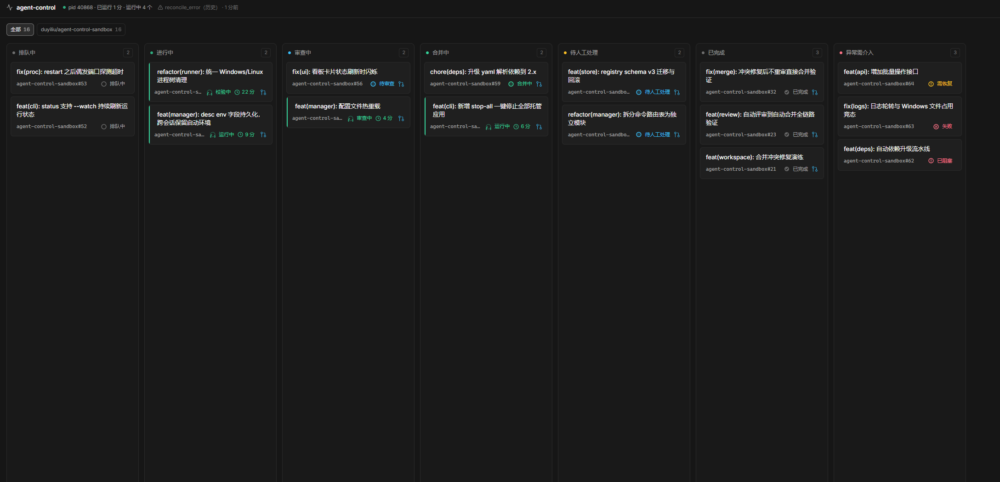

# agent-control

个人 AI 研发调度中心：配置项目自动接手 GitHub Issue，常驻调度器自动完成

```
领取 → git worktree 隔离 → Pi agent 实现 → 受信 checks → push + Draft PR
→ 独立只读评审 → Checks + Review PASS 后 Ready for review → 人工审查/合并
```

调度器的发布动作（push、建 PR、合并）都在宿主侧执行，agent 子进程不注入 GitHub 凭据（残余敞口见「安全边界」）。当前只支持 Pi runner。

## 前置依赖

| 依赖 | 说明 |
|---|---|
| Node ≥ 22.13 | 使用内置 `node:sqlite`，低于此版本起不来 |
| git + GitHub CLI | `gh auth login` 完成认证；发布 PR、探测合并状态、读写标签都在宿主侧执行 |
| Pi | `npm i -g @earendil-works/pi-coding-agent`，并确认 `pi --version` 在 PATH 上；模型配置在 `~/.pi/agent/models.json` |
| 仓库标签 | `labeled` 模式需 `agent-ready`；`all` 不要求 ready；系统标签由 doctor 检查。doctor **只验不建**，缺失时显示 `UNVERIFIED`。从 UI 添加项目时会尝试创建缺失标签 |

```powershell
'agent-ready','agent-running','agent-blocked','agent-pr','agent-reviewing','agent-high-risk','agent-merge','agent-review','agent-needs-human','agent-human-hold' |
  ForEach-Object { gh label create $_ -R owner/repo --force }
```

`agent-ready`、`agent-running`、`agent-blocked`、`agent-pr`、`agent-high-risk`、`agent-needs-human`、`agent-human-hold` 打在 Issue 上；`agent-reviewing`、`agent-merge`、`agent-review` 打在 PR 上。

`~/.pi/agent/models.json` 最小形态（OpenAI 兼容网关示例）：

```json
{
  "providers": {
    "new-api": {
      "name": "new-api",
      "baseUrl": "http://<网关地址>:3002/v1",
      "api": "openai-completions",
      "apiKey": "<key>",
      "models": [
        { "id": "deepseek-v4.1-flash", "contextWindow": 1000000, "maxTokens": 8192 },
        { "id": "GLM-5.3-Flash", "contextWindow": 1000000, "maxTokens": 8192 }
      ]
    }
  }
}
```

`agent-control.yaml` 里的 `agent.model` 以 `<provider名>/<模型id>` 引用（如 `new-api/deepseek-v4.1-flash`），**必填——缺失直接拒绝启动**。`agent.reasoning_effort` 是可选 Pi 思考级别（`off`/`minimal`/`low`/`medium`/`high`/`xhigh`/`max`）；不配置时使用 Pi 默认值。

Issue 标注 `agent-complex` 后，该任务的所有编码回合（首次实现、修复、冲突修复）改用 `agent.complex_model` 和 `agent.complex_reasoning_effort`；未配置时回落到 `agent.model` / `agent.reasoning_effort`。复杂度由人工显式声明，不做自动推断。

编码与评审都走 Pi。评审可用 `review_model` 和 `review_reasoning_effort` 单独选择模型与思考级别。旧配置里的 `provider: codex`、`review_provider`、`sandbox`、`review_sandbox` 会被明确拒绝，请改用 `provider: pi` 并按 Pi 格式配置模型。

## 快速开始

```powershell
npm install
copy config.example.yaml agent-control.yaml   # 编辑 repo / local_repo / 数据目录 / 模型
npm run ac -- doctor                          # 环境检查
npm run ac -- start                           # 启动常驻调度
```

需要 Web 管理界面时，首次还要安装并构建前端（`ui/dist` 不在仓库里）：

```powershell
npm --prefix ui install
npm run ui:build
```

配置查找顺序：`--config <path>` > 环境变量 `AGENT_CONTROL_CONFIG` > `./agent-control.yaml` > `./config.yaml`。

其他命令：

```powershell
npm run ac -- status          # 调度状态 + 任务一览（含最近内部错误）
npm run ac -- runs <issue>    # 单任务事件时间线 + checks 证据
npm run ac -- stop <issue>    # 安全取消（一个取消轮询周期内生效）
npm run ac -- retry <issue>   # 以当前 Issue 内容重新批准并入队
npm run ac -- drain           # 暂停派发新任务并等在途 run 收尾（--timeout-seconds 默认 600）
npm run ac -- undrain         # 恢复派单
```

多项目配置时，`runs`、`stop`、`retry` 需要加 `--repo owner/name`。

## 配置要点

配置骨架见 `config.example.yaml`，常用项说明：

人工评审新策略通过 `review_policy.version: 2` 显式启用，默认仍为 1。
v2 中兼容新增、版本号及改动大小本身不会转人工：具体缺陷交 AI 修复，
证据缺口交 AI 补测试，临时执行故障按 30 秒、120 秒退避恢复；只有具体产品
取舍、破坏性变化和敏感/保护路径授权才要求逐项回答。执行受阻单独显示，
不计入“待你决策”。AI PASS 只把 PR 交给人工审查，不会自动合并；`agent-merge`
仍表示人工明确批准合并。`approvals.auto_merge.enabled` 仅为旧配置兼容项，不再授权 AI 自动合并。

v2 每个需求版本共用 6 轮评审、3 次执行失败及 `server.retry_limit` 修复预算，
默认每轮评审 10 分钟（可设 `review_policy.timeout_minutes`，且不超过任务时限）。
重启、分段、新提交均不重置预算；人工重试/重评会记录续期，保留历史证据。
冲突修复的新提交必须重新评审，旧批准失效。普通批准或 `agent-merge` 标签不能
回答授权问题、绕过检查或未闭合缺陷。`projects[].human_review_paths` 匹配完整
diff，包含文档和生成物；manual 模式也执行宿主保护核验。

启用只影响新任务；历史待人工记录需显式点击“重新评审”升级，暂缓/无需处理
不会自动恢复。已关闭 Issue 且 PR 未合并的记录归为“外部关闭”，不冒充代码完成。
v2 的 `max_files/max_lines` 仅作评审规划阈值；下表风险升级说明适用于旧策略。

只读统计：`npx tsx scripts/review-policy-report.ts <数据库路径>`。按非 sandbox 的
Issue 任务去重，输出首次自动闭合率、人工决策率、当前执行受阻率及尝试次数，
同时说明分母、legacy 排除项与人工续期；不会把重复评审当成多个任务。

升级前排空停机并备份数据库和配置。schema v12 不支持旧二进制原地降级，
回滚必须停机还原升级前备份并配套旧代码；服务与 CLI 的 Store 均拒绝更高版本库。

| 字段 | 默认 | 说明 |
|---|---|---|
| `server.poll_interval_seconds` | `30` | 调度 tick 间隔 |
| `server.max_concurrent` | `1` | 编码 run 与评审 run 共用的并发上限 |
| `server.retry_limit` | `3` | 单 run 内修复次数上限，也是任务级修复 run 的轮次上限 |
| `server.max_resumes` | `2` | 单个 run 崩溃后允许自动恢复的次数（非负整数）；`0` = 不启动恢复执行，需执行的 run 一律 `RECOVERY_REQUIRED`（`PUBLISHING_PR` 已有 PR 的仍可对账收尾） |
| `server.max_task_minutes` | `45` | 单次 agent 调用的超时（不含排队与 checks） |
| `server.cancel_poll_seconds` | `5` | cancel 标志的独立轮询间隔 |
| `server.logs_dir` | `<database 所在目录>/logs` | 事件流与 artifacts 目录 |
| `server.ui.port` | `8787` | 内嵌 Web 面板端口 |
| `server.ui.token` | 未设置 | 配置后所有路由（含静态资源）要求鉴权；暴露到非 loopback 前必须设置 |
| `projects[].review_mode` | `auto` | `auto`：每个 PR head 自动派独立评审 run；`manual`：不派评审 |
| `projects[].issue_intake` | `labeled` | `all` 自动接手全部开放 Issue，无需 ready；`labeled` 保留标签入口 |
| `projects[].issue_triage.enabled` | `false` | 旧配置兼容：true 映射到 all；显式 issue_intake 优先，timeout_seconds 已弃用 |
| `projects[].checks[].argv` | — | 无 shell 执行；`timeout_seconds` 默认 `600` |
| `agent.model` | 必填 | `<provider>/<model id>`，来自 `~/.pi/agent/models.json` |
| `agent.reasoning_effort` | 未设置 | 常规编码的 Pi 思考级别；未设置时使用 Pi 默认值 |
| `agent.complex_model` | 同 `agent.model` | `agent-complex` 任务的编码模型 |
| `agent.complex_reasoning_effort` | 同 `agent.reasoning_effort` | `agent-complex` 任务的思考级别 |
| `agent.review_model` | 同 `agent.model` | 评审模型，可用来做异构评审 |
| `agent.review_reasoning_effort` | 同 `agent.reasoning_effort` | 评审思考级别 |
| `approvals.auto_merge.enabled` | `false` | 兼容旧配置；AI PASS 不会自动合并。人工 `agent-merge` 批准仍可触发宿主合并 |
| `approvals.auto_merge.max_files` | `10` | 保留旧风险配置；文件数本身不替代人工审查 |
| `approvals.auto_merge.max_lines` | `400` | 保留旧风险配置；改动大小本身不替代人工审查 |
| `approvals.auto_merge.generated_paths` | `dist/**`、`*.generated.*`、`*.min.*`、`*.map` | 构建产物：不参与风险统计，也不进入评审 diff |
| `approvals.auto_merge.doc_paths` | `docs/**`、`**/*.md` | 文档：不参与大小闸门 |
| `projects[].verify_build` | 未设置 | 合并前重建并比对生成物；与提交不一致 → 阻止合并转人工。`approvals.auto_merge.verify_build` 可作全局兜底，项目级优先 |
| `projects[].verify_bootstrap` | 未设置 | 编码 worktree 不可用时（如 existing-PR 任务），在被批准 SHA 的 detached worktree 上先跑此命令装依赖再构建，如 `npm ci`。无编码 worktree 且无 bootstrap 时构建多半失败转人工 |

`checks.argv` 直接以进程参数数组启动，不经过 shell。Windows 上 `npm`/`npx` 会解析到 Node 入口；其他 `.cmd`/`.bat` 需显式配置可执行入口，否则记基础设施错误。

未配置 `checks` 时，Issue 编码任务从工作树 `package.json` 自动识别 npm `check`；没有组合入口时识别 `test`、`typecheck`、`compile`（缺少 compile 则使用 build）。只执行这些固定脚本名；若没有适用检查，AI Review 仍可提供意见，但 PR 保持 Draft 并说明需要人工补充验证。新工作树有 package-lock.json、无 node_modules 时先执行 npm ci；安装失败属于环境错误。显式配置的非空 checks 优先。

Issue 关联 PR 重新评审时，会补跑该提交缺失的宿主检查，命令、真实日志和结果按 SHA 记录；同一 SHA 的对应检查已通过则复用证据。独立外部 PR 保持只读评审，不执行其代码。所有检查继续使用凭据隔离和 HEAD/工作树守卫。

把项目切到 `review_mode: manual` 时，不再派发自动 Review；在途的人工合并仍受 SHA、需求哈希和检查门禁保护。

## 使用流程

一条主线：**提 Issue → 排队 → 同一个 Coder 会话实现与修复 → Draft PR → 独立 Review → Ready for review → 人工审查与合并**。

### 1. 下任务

在托管仓提 Issue，正文写清背景、范围、验收标准、测试命令和依赖。

### Issue 自动接手

项目配置 `issue_intake: all` 后，程序分页发现所有开放 Issue 并创建唯一任务卡，无需 `agent-ready`；扫描不调用 AI。同一个编码 Agent 读取需求和必要代码，能实现则继续，缺信息则转人工，等待条件则暂缓，无需处理则进入历史。

只保留执行看板。卡片显示原因、人工锁定和同步状态，提供“继续处理、暂缓、人工锁定”。暂缓及无需处理通过同一看板的筛选查看。修改 Issue 不会自动解除人工处置，需显式继续。

暂缓可选提醒时间，到期时在“暂缓”筛选和卡片中提示，仍需点击“继续处理”才会派工。提醒不会自动撤销人工锁定。

待人工的 PR 在详情中展示具体原因、建议操作和“重新评审”。重新评审核对当前任务版本、开放 PR、需求快照及人工门禁，撤销旧评审的幂等标记与未消费的合并批准，保留代码、检查证据和历史事件；manual 项目仍由人工审阅。独立 PR 只提供重评和 GitHub 处理入口，不显示“批准合并”。

处置保存在本机 SQLite，每个仓库由一个实例管理自动入口。GitHub 的 `agent-human-hold`、`agent-needs-human` 仍会阻止启动。人工操作先保存，需移除远端门禁时后台同步，成功前不会派发；重复解锁不会重新加锁。

`issue_intake: labeled`（默认）保留原来的 ready 标签入口。旧 `issue_triage.enabled: true` 兼容为 all，不再运行独立 AI 评估，旧 timeout_seconds 不再使用。首次切换保留旧 HUMAN/DEFER/SKIP 和任务历史；损坏或未结束的旧认领显示为阻塞卡，核验后恢复。

自动接手新 run 的最终消息使用 JSON `{"outcome":"IMPLEMENTED|NEEDS_HUMAN|DEFER|NO_ACTION","reason":"具体原因"}`。非实现结果必须没有代码修改或提交；否则保留现场交人工，绝不直接发布。旧 run 与 labeled 模式保持旧输出协议。

若 UI 绑定非 loopback，自动接手必须配置 `server.ui.token`。

### 2. 自动执行

下个轮询周期自动领取，全程无干预：

```
CLAIMED → PREPARING（建 worktree）→ RUNNING（Pi 编码）
→ VERIFYING（宿主执行受信 checks）⇄ FIXING（失败修复）
→ PUBLISHING_PR（宿主 push + 建 Draft PR）
```

checks 失败会自动进入修复回路，同一个编码 run 内最多修复 `retry_limit` 次；预算是按 run 计算的，重启或恢复不会重置。修复后重新跑全部 checks，直到通过或预算耗尽。

原始证据在 `<logs_dir>`：`agent-control.jsonl` 事件流，以及 `artifacts/<run_id>/` 下的 agent 日志、测试日志、review 结论、`review-diff.patch`、`run-*.jsonl`。

### 3. 评审与合并

编码 run 结束后，根据 `projects[].review_mode` 分流：

同一 Issue 的所有编码和修复 Run 共用首个 code Run 的 Pi 会话 ID / 历史目录；每个 Run 的进程、PID、日志和恢复计数仍独立。Review BLOCK 后的新 Reviewer 会收到宿主保存的上一轮 findings 和修复摘要。

**`auto`（默认）**

1. PR 进入 `AWAITING_REVIEW`，调度器按 PR head sha 派发一个独立评审 run（`kind='review'`）。同一 sha 已有任何评审结论（PASS/BLOCK/HUMAN_REVIEW_REQUIRED/ERROR）就不再重复派发；head 移动或本轮被取消时写不出结论，新 sha 会被重新评审。
2. 评审现场是该 sha 的本地物化：优先复用编码 worktree（仅当 HEAD 正好是该 sha 且工作区干净），否则新建 detached worktree。评审结束后宿主校验 HEAD 未移动、工作区干净；被改动或 HEAD 被移动 → `ERROR` 结论并转人工，不会采纳评审意见。
3. 结论处理：
   - **PASS 且当前 SHA 的宿主 Checks 实际通过**：宿主复核 Issue 授权、锁、取消、HEAD 和 base，将 Draft 转 Ready，发布交接摘要，任务进入 `AWAITING_HUMAN`。AI PASS 不会进入 `MERGING`。
   - **PASS 但检查缺失、PR 状态变化或 Ready 操作失败**：保留 Draft（恢复失败时给出人工核验原因），不显示正常交付完成。
   - **BLOCK 且有具体 findings 且任务级修复预算未耗尽**：写 `pending_fix`，任务回 `DISCOVERED` 派生修复 Run；Coder 恢复该 Issue 首个编码 Run 的 Pi 会话历史。修复后重新 checks + 独立评审；新 SHA 不继承旧结论。修复 Run 没有产生新提交（HEAD 仍是评审 sha）→ `BLOCKED`。
   - **BLOCK 但无 findings 或预算耗尽** → `BLOCKED`。
   - **评审基础设施不可用**（现场物化失败、diff 不可得、reviewer 进程失败等）→ 记 `ERROR` 或 `HUMAN_REVIEW_REQUIRED`，转 `AWAITING_HUMAN` + `agent-high-risk`，不消耗修复预算。

**`manual`**

不派评审 run。PR 直接停在 `AWAITING_HUMAN`，由人审。可以直接在 GitHub 合并，也可以在 PR 上打 `agent-merge` 让宿主执行合并。

### 4. 人工批准合并

任务停在 `AWAITING_HUMAN` 时，在 PR 上打 `agent-merge` 标签即表示“批准合并”，Web 面板的「批准合并」按钮等价。

- 标签是**一次性**的：调度器消费前先删除标签，再转 `MERGING`。
- `auto` 模式下批准绑定最近一次评审结论的 sha。PR head 或 base 已变化时，批准作废，PR 回到 Draft 并重新评审；绝不合未经评审的版本。
- `manual` 模式没有评审结论，批准的是打标签时的当前 head。
- `MERGING` 由宿主每个 tick 推进：重新校验 PR head == `approved_sha`，执行 `gh pr merge --squash --match-head-commit`。合并成功后 `COMPLETED`，并触发 worktree/分支清理（best-effort）。

人工批准后若合并冲突，宿主可派生修复 Run；修复 push 的新 HEAD 会清除旧批准并回到 Checks/Review 队列。冲突修复完成后必须再次人工批准新 SHA。非冲突的合并失败按次数重试，`merge_attempts` 达到 20 次仍未成功 → `AWAITING_HUMAN` + `agent-high-risk`。

### 5. 停止与异常

| 情况 | 表现 | 处理 |
|---|---|---|
| checks / 评审修复预算耗尽 | `BLOCKED`，Issue 收到评论 | 看 `runs <issue>` 证据，人工处理或 `retry` |
| 执行/评审期间 Issue 内容被改 | `BLOCKED_APPROVAL_CHANGED` | `npm run ac -- retry <issue>` 重新批准当前内容 |
| 中途叫停 | 活动 run 被取消 | `npm run ac -- stop <issue>` |
| 服务正常停机（SIGTERM/SIGBREAK） | 活动编码 run 挂起，保持当前相位 | 不取消、不释放 `agent-running`；下次启动对账自动续行 |
| 服务崩溃 | 启动时先对账 | 能证明子进程已死、现场可用且恢复预算内 → 自动从已存相位续行；否则 `RECOVERY_REQUIRED` |
| PR 被关闭 | `BLOCKED` | 人工重开原 PR，或新建任务 |

`stop` 的具体行为：

- 有活动 run：请求取消，`cancel_poll_seconds` 内中止（取消信号会传到 checks 子进程）。
- `AWAITING_REVIEW`：退出自动评审，转 `AWAITING_HUMAN`。
- `MERGING`：退出自动合并，转 `AWAITING_HUMAN`。
- `DISCOVERED` 且带 `pending_fix`：取消，待执行的修复意图一并作废。

`retry` 只接受 `BLOCKED`、`BLOCKED_APPROVAL_CHANGED`、`FAILED`、`CANCELED`、`RECOVERY_REQUIRED`。重试前会检查旧 PID 身份和 worktree 孤儿进程；无法证明旧进程已退出则拒绝。若 Issue 上仍有 `agent-running` 标签，需先确认没有其他调度器持有它，再人工移除。

`RECOVERY_REQUIRED` 对 `agent-running` 的处理是保守的：只有已证明旧子进程不存在的停车（恢复预算耗尽、worktree 缺失、GitHub 查询失败等）才会顺带摘除 issue 的 `agent-running` 标签，避免它无限期挡住重试或其他实例；pid 可能存活、worktree 有孤儿进程、或扫描失败时标签一律保留——摘除失败只记日志，不影响本地停车。

### 6. 维护窗口：drain / undrain

升级或维护前的标准顺序是「先停派单，再等收尾」：

```powershell
npm run ac -- drain --timeout-seconds 600
# 排空成功后调度仍保持暂停，此时重启服务（计划任务 / systemctl）
# 重启后确认服务健康（status / UI / 日志 reconcile_done）
npm run ac -- undrain
```

- `drain` 只暂停**新工作**：发现、code/review 派单、merge sweep 全部停；在途 run 和崩溃恢复队列继续正常收尾，**不取消任务、不强杀进程**。
- 请求持久化在数据库里：重启后仍处于暂停态，启动对账会先把崩溃前在途的 run 恢复完再继续排空。
- 确认条件严格：只有调度器在 tick 完全收尾后确认无任何在途 run，才写回本次请求的 ack。服务没运行或卡住不确认时，`drain` 到 `--timeout-seconds`（默认 600，正整数）后以非 0 退出，暂停标记保留。
- `status` 第一行显示「运行中 / 排空中 / 已排空」；`undrain` 清除暂停标记，下个 tick 恢复派单。
- `drain`/`undrain` 不重启服务。`systemctl restart` 发的是 SIGTERM，走优雅停机：在途编码 run 挂起（保留相位与 `agent-running`），下次启动对账自动续行，不再取消。Windows 计划任务停止/`schtasks /end` 是强杀，不保证走到停机 handler——其效果等同崩溃，已落盘的 Pi 会话仍可恢复，但需按崩溃对账路径走 PID/孤儿检查。

## 质量闸门

- **checks 是受信的**：命令只来自仓库配置，不来自 Issue。checks 执行前后都会校验 HEAD 和工作区；测试过程中代码被改动 → `BLOCKED`。命令启动失败、超时或异常终止记基础设施错误，不自动修改业务代码。
- **评审是独立的**：评审 run 与编码 run 分离，绑定一个 PR head/base SHA；宿主刷新并用该 PR 当前 base SHA 生成完整 diff。评审子进程只拿到只读工具白名单（`read`/`grep`/`find`/`ls`），没有 shell、edit、write。评审是一次性 `pi -p --no-session` 调用；后续轮次只接收宿主记录的 findings 和修复摘要，不复用 Reviewer 会话。
- **证据绑定 SHA**：checks 与 review 结论都写入 `check_results.head_sha`。评审证据只取被审 sha 对应的检查结果；历史数据没有 `head_sha` 时会明确告知评审“证据未绑定当前 SHA”。
- **评审只拦有证据的问题**：仅对可复现的正确性、验收或越界问题返回 `BLOCK`，findings 必填。风格偏好、可选重构和超出任务范围的改进不作为阻塞项。
- **大改动分段评审**：宿主保存完整差异，超过单轮 12 万字符时按文件/完整 hunk 切分，最多 8 段；各段均低风险通过后，再做跨文件汇总审查。分段和汇总共享整轮时间预算，任何分段的阻塞或高风险不能被汇总覆盖。单个 hunk 超限、超过段数预算或差异已截断时仍转人工。格式纠正最多重试两次，持续不合规的输出不能授权自动合并。
- **失效即转人工**：评审现场物化失败、diff 超过分段容量/不可得、HEAD/工作区被改动、评审输出无法恢复，统一转人工，不惩罚编码成果。即使从叙述中恢复出结论，也会强制按高风险处理，不自动合并。
- **恢复不重复执行**：重启时若无法证明旧子进程已死，进入 `RECOVERY_REQUIRED` 而不是再起一个；每个 run 最多自动恢复 `server.max_resumes` 次（默认 2），预算耗尽同样转人工。
- **Coder 会话跨 Run 持久化**：同一 Issue 的编码会话 ID 和历史目录锚定首个 code Run（`--session-id <首个 run_id>` / `--session-dir <首个 run artifacts>/pi-session`），后续 Review 修复 Run 恢复同一份历史；每个 Run 仍独立记录进程、PID、日志和恢复次数。会话目录只认绑定 ID 与工作目录的头记录，损坏、错配或含糊时保留现场并安全停车，不悄悄冷启动。
- **恢复语义有边界**：被切断前未落盘的流式 token、正在执行的外部命令无法保证恰好一次；恢复后由提示词引导先 `git status`/`git diff`/`git log` 核实现状再续做。升级前用 `--no-session` 跑的旧 run 没有历史可找回，只能无上下文续做（行为同前版）。服务停机不等同于取消：挂起的 run 记 `service_shutdown` 事件、`cancel_requested` 仍为 0；`stop <issue>` 的显式取消优先于停机，仍然落 `CANCELED`。

## Web 管理界面

`start` 起的调度器内嵌一个看板（`ui/` 独立前端：Vite + React + Tailwind，构建产物 `ui/dist` 由调度器的 `node:http` 静态服务提供）：

```
http://127.0.0.1:8787     # 端口以 agent-control.yaml 的 server.ui.port 为准
```

看板示例：



- **七列看板**：排队中 → 进行中 → 审查中 → 合并中 → 待人工处理 → 已完成 → 异常需介入。卡片带 repo#issue、相位徽章、实时运行时长和 PR 链接；支持按仓库筛选、按 `/` 聚焦搜索、5 秒自动刷新。
- **详情抽屉**：相位时间线（`run_events`）、checks 结果、修复轮次、实时日志（跟随/暂停、原始 JSONL）、artifact 弹窗（测试日志、review 结论、`review-diff.patch`、`run-*.jsonl`）。`.jsonl` 会逐行解析成事件流；服务端强制路径必须落在 `logs_dir` 内，越界访问返回 403。
- **操作**：停止、重试、批准合并，均有确认弹窗；进行中的卡片也可以拖到「异常需介入」触发停止。所有写操作与 CLI 走同一 Store/ops 路径，两者可以混用。
- **健康条**：pid、uptime、当前进程内活动 run 数、最近一次内部错误。
- **主题**：顶部可切换 5 套配色，选择存在浏览器本地。

### 鉴权

默认无鉴权，只应绑定 loopback。需要暴露到非本机入口（内网穿透、反代）时，必须配置 `server.ui.token`：

- 配置后所有路由（包括静态资源）都要求鉴权。
- 支持 `?token=<token>` 一次性种 HttpOnly cookie（随后 302 去掉 URL 中的 token）、`Authorization: Bearer <token>`，或已种下的 `ac_ui_token` cookie。
- 未鉴权访问 API 返回 401 JSON，访问页面返回极简 token 输入页。

### 开发与构建

```powershell
npm --prefix ui install
npm run ui:dev       # Vite dev server，/api 代理到 8788
npm run ui:build     # tsc + vite build → ui/dist
npm run ui:typecheck
```

调度器每个请求都会重新读取 `ui/dist`，所以改完前端只需 `npm run ui:build` 并刷新浏览器，**不需要重启服务**。`ui:dev` 的代理目标写死在 `ui/vite.config.ts` 的 `8788`；如果你的 `server.ui.port` 不是 8788，需要一起改。UI 启动失败（如端口被占）只记警告，调度不受影响。

## 常驻服务

### Windows 计划任务

前台验证通过后注册计划任务，登录即自启：

```powershell
schtasks /create /tn agent-control /sc onlogon /f /tr 'powershell -NoProfile -ExecutionPolicy Bypass -WindowStyle Hidden -File "<repo>\agent-control-service.ps1"'
schtasks /run /tn agent-control     # 立即拉起
schtasks /end /tn agent-control     # 停止外层任务（不会杀 node 孙进程，见下）
schtasks /delete /tn agent-control  # 卸载
```

- `agent-control-service.ps1` 只做两件事：`cd` 到仓库根、把 `npm run ac -- start` 的输出追加到 `<数据目录>\logs\service.out.log`。脚本里的日志目录按本机约定写死，数据目录不同的环境先改它。
- 单实例由 `<database 所在目录>/agent-control.lock` 心跳锁保证：旧进程死透后新实例自动接管；两个实例同时存在时后到者直接退出。锁不会因为心跳过期就盲目抢占——只有 PID 已死或 PID 被复用时才判定为 stale。
- onlogon 只保证“登录后起来”，**不管崩溃自愈**；需要真自愈请上 NSSM 或给任务配 restart-on-failure。

重启时注意：`schtasks /end` 只结束计划任务的外层 powershell/npm，node 孙进程可能还在跑并持有锁。按下面顺序重启：

```powershell
schtasks /end /tn agent-control
Get-CimInstance Win32_Process |
  Where-Object { $_.CommandLine -match 'cli\.(mjs|ts|js).*start' } |
  Stop-Process -Force
schtasks /run /tn agent-control
```

重启后确认任务状态为 `Running`，`agent-control.lock` 里是新 pid 且心跳是新的；配置了 token 时，未带凭据访问 `GET /api/health` 应返回 401。

### Linux systemd

Linux 上没有单实例脚本可复用，直接用 systemd 托管，systemd 负责停旧起新：

```ini
# /etc/systemd/system/agent-control.service
[Unit]
Description=agent-control scheduler
After=network-online.target

[Service]
Type=simple
WorkingDirectory=/root/git/agent-control
Environment=HOME=/root PATH=/usr/local/node22/bin:/usr/local/bin:/usr/bin:/bin
ExecStart=/usr/local/node22/bin/node --import tsx src/cli.ts start
Restart=on-failure

[Install]
WantedBy=multi-user.target
```

```bash
systemctl daemon-reload
systemctl enable --now agent-control
systemctl status agent-control
systemctl restart agent-control
journalctl -u agent-control -n 50 --no-pager
```

- `PATH` 必须包含 `pi` 所在目录（`/usr/local/node22/bin`），否则 `which('pi')` 找不到 runner；交互式 SSH 的 PATH 不含它时，手动跑 `npm run ac -- doctor` 会误报 `pi not on PATH`，而服务本身正常。
- 重启后看三件事：`systemctl is-active` 为 `active`、`<logs_dir>/agent-control.jsonl` 尾部有 `ui_start` + `reconcile_done`、`agent-control.lock` 是新 pid 且心跳是新的。
- `Restart=on-failure` 提供崩溃自愈；单实例仍由心跳锁保证，systemd 之外的重复启动会直接退出。

## 安全边界

- **只接入你本人撰写或已确认可信的 Issue。** Issue 正文只作为数据注入提示词，但这只是约定，不是强制边界。编码 agent 以当前 Windows 用户权限运行，拥有完整的文件系统读写能力；worktree 是工作目录约定，不是文件隔离。恶意 Issue 最坏可诱导 agent 在当前用户权限范围内写任意文件（包括 worktree 之外），代码变更再由 checks、独立评审和合并前的风险闸门拦截，但无法撤销已经发生的越界写入。不要对非本人撰写、来源不明的 Issue 启用本工具。
- **子进程环境是白名单**：只继承 PATH、用户目录、代理等最小集合；`GH_TOKEN`、`GITHUB_TOKEN` 及任何 `*_KEY`/`SECRET` 都不会传入。磁盘凭据也被切断：`GH_CONFIG_DIR` 指向空 jail → 子进程 `gh` 报未登录；`credential.helper` 清空 + 禁止终端提示 → `git` 取凭据失败；`GIT_SSH_COMMAND` 死结。**残余敞口**：`gh` 凭据实际存在 Windows 凭据管理器（keyring）中，同用户进程可以通过 `CredRead` API 读取。绕开正常 gh/git 路径需要诱导 agent 主动编写 keyring 读取代码，属于平台限制。
- **评审是只读的**：评审子进程只有 `read`/`grep`/`find`/`ls` 工具，没有 shell、edit、write；评审后宿主还会校验现场 HEAD 未移动、工作区干净。Pi 不提供操作系统级沙箱，编码依赖提示约束和宿主检查。
- **发布与合并是宿主行为**：push、建 PR 只由宿主执行，编码子进程没有发布权限。PR 一律以 **Draft** 创建；最新 SHA 的宿主 Checks 和独立 Review 都通过后才转 Ready。合并需要人工明确决定（`agent-merge` 标签 / 直接在 GitHub 合并），再由宿主以 `--match-head-commit` 钉住批准的 SHA。
- **审批内容哈希**：SHA-256 覆盖 Issue 标题和规范化正文。`DISCOVERED` 对账以及每个 code/review run 的 phase gate 都会校验；内容变化 → `BLOCKED_APPROVAL_CHANGED`，必须人工 `retry` 重新批准。人工批准合并时以 PR 当时 head 为准；auto 模式下该 head 必须等于被审 sha。
- **重启先对账**：无法证明旧子进程已死 → `RECOVERY_REQUIRED`，绝不重复执行；确认已死 → 按已存相位幂等续行。恢复时 GitHub 查询失败不等于授权撤销，不会关闭 PR。

隔离路线的历史讨论：容器隔离方案曾实现于 `container-isolation` 分支，但在“只跑本人 Issue + 评审与批准把关”的纪律下成本收益不成立，保留为未来接入非本人任务源时的备选。轻量加固方向（未实施）是用专用低权限 Windows 账户跑 agent 子进程，配合 ACL 限制文件系统、按账户配置出站防火墙。

## 状态机

编码 run：

```
DISCOVERED（任务入队）
→ CLAIMED → PREPARING → RUNNING → VERIFYING ⇄ FIXING → PUBLISHING_PR
→ AWAITING_REVIEW（auto） / AWAITING_HUMAN（manual）
```

评审 run（`kind='review'`）：`CLAIMED → REVIEWING → 终态（COMPLETED / AWAITING_HUMAN / BLOCKED / CANCELED 等）`，结论另记为 `PASS`/`BLOCK`/`HUMAN_REVIEW_REQUIRED`/`ERROR`，绑定一个 PR head sha。`MERGING` 是任务状态，不是 run 相位，由宿主侧 merge sweep 推进。

| 状态 | 含义 |
|---|---|
| `DISCOVERED` | 已发现、待领取；带 `pending_fix` 时表示已排队一轮修复 run |
| `REVIEWING` | 独立评审 run 正在执行 |
| `AWAITING_REVIEW` | PR 已开，评审待派；head 移动或评审被取消时回到这里重派 |
| `AWAITING_HUMAN` | 需要人工处理：评审结论不能自动落地，或 manual 模式等人审 |
| `MERGING` | 宿主正在钉 sha 落地：失败重试、冲突派生修复 run、超限转人工 |
| `COMPLETED` | PR 已合并；worktree 和分支进入清理（best-effort） |
| `BLOCKED` | 需要人工介入（checks/评审预算耗尽、PR 被关闭等） |
| `BLOCKED_APPROVAL_CHANGED` | 批准后 Issue 内容变化，需重新批准 |
| `FAILED` | agent、checks 基础设施或发布流程失败 |
| `CANCELED` | 被人工停止，或 Issue 关闭/标签撤销 |
| `RECOVERY_REQUIRED` | 服务重启时无法安全判定/续行，等待人工确认 |

run 的相位迁移写入 `run_events`；测试与评审证据写入 `check_results`（含 `head_sha`）。

## 开发

```powershell
npm test              # node:test 全套（含真实 git worktree 用例）
npm run typecheck     # tsc --noEmit
npm run ui:typecheck  # 前端类型检查
npm run build         # → dist/ + ui/dist（ui/dist 不入库，发版必须重建）
```

## 相关文档

- [`ROADMAP.md`](ROADMAP.md) — 当前单机优先级与未来 Controller / Worker 分布式演进规划（未排期）。
- `WORKFLOW.md` — 注入到每次编码 prompt 的可信执行契约。
- `config.example.yaml` — 带注释的配置示例。
- `docs/design-workflow.md` — 设计与执行分离的流程约定（合并语义以本 README 为准）。
- `docs/pr-review-optimization-plan.md` — PR 反馈回路的优化提案（历史）。
- `work/任务/` — 历史设计与任务记录，仅作背景，不代表当前实现。
