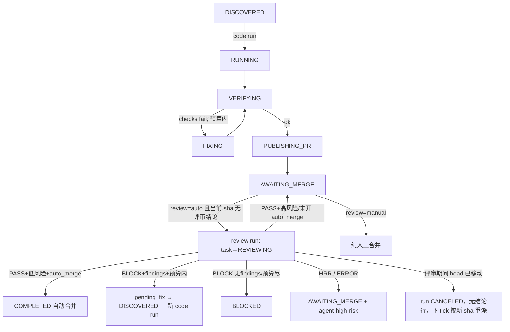

# Review 独立任务化

> 设计审查：PASS
> 审查模式：independent（subagent_explore）
> 设计审查轮次：2/3
> 设计审查范围与结论：第 1 轮覆盖全设计 + engine/recovery/sqlite/review/types/prompts/config/ops/ui/api/app/publish/tracker 现状对照，FAIL（4C/5H/7M/7L）；第 2 轮增量复审未闭合项与受修订范围，PASS（4C/5H 全闭合并有 AC，遗留 3M/9L 为规格精度问题）。v2.1 已折入复审 M1–M3 与可用 Low（L1–L8），均为澄清非契约变化。
> 设计版本：v2.2（评审现场机制改进：由"复用编码 worktree"改为"被审 sha 的本地物化"，契约不变，属已审范围内实现机制优化）
> 设计确认：已确认
> 设计确认依据：用户回复"实施吧"（2026-10-20），对应设计版本 v2.2（含评审现场物化改进）
> 实施后修订（v2.3）：用户决策"全部默认走自动评审"——`projects[].review` 配置项与 `agent-review-auto`/`agent-review-manual` 覆盖标签已移除，每个发布的 PR head 一律自动派发评审 run；manual 路径的对外出口即"评审 PASS 高风险/HRR/ERROR → 人工合并"。配置层见到 `projects[].review` 键直接拒绝并提示迁移。
> 本文件只保存稳定设计基线；执行进度、实施清单、返工状态统一放同目录 `tasks.md`。

## 1. 背景与范围

### 背景

当前 `REVIEWING` 是编码 run 内部的一个 phase：`VERIFYING → PUBLISHING_PR → REVIEWING`，评审 BLOCK 时在同 run 内走 `FIXING` 复用 coder RPC 会话。问题：

- review 与编码耦合在同一 run 生命周期：评审期间 coder 会话空挂、崩溃恢复要处理"评审中"中间态；
- 无法按任务选择评审策略：现在所有 PR 一律机器评审；
- "评审"抽象不独立：未来接入外部评审者（Codex bot、人工认领）时还得再造独立评审的壳。

用户决策：**去掉"内部 review"概念，评审变成 PR 创建之后的可选动作；评审是一等独立 run；按任务配置决定"自动评审→通过自动合并"还是"纯人工/外部 reviewer 合并"。**

### 目标

- 编码 run 状态机收敛为 `…→ VERIFYING → PUBLISHING_PR → AWAITING_MERGE`，不再含 REVIEWING；
- 评审成为独立调度的 run（kind=review），绑定 PR 的 head_sha，可独立重试、独立观测；
- 评审策略按项目配置、按 issue 标签覆盖；
- 评审 BLOCK → 派生新一轮编码 run（冷启动修复），环路受任务级预算约束；
- checks 失败的原地 FIXING 环路不变（RPC 会话价值保留）；
- 外部评审者与内置评审同构：都是"对某 PR head_sha 出结论"。

### 非目标

- 跨机器/跨实例的评审执行（`agent-reviewing` 标签仅作可见性与本实例去重）；
- 评审多轮对话（reviewer 仍为一次性 `pi -p` 只读调用）；
- 外部评审结果回执协议（PR comment 解析）；人工走 GitHub 原生合并由 mergeReconcile 对账；
- checks 失败改独立修复任务——原地 FIXING 保留；
- UI 大改（评审 run 复用现有 run 详情、LiveLog、事件视图，仅补 kind 字段）。

### 本次范围

- `src/types.ts`：Phase 语义重释、run kind、`RunRow.kind` / `TaskRow.pending_fix` / `CheckResultRow.head_sha`；
- `src/store/sqlite.ts`：schema v4 迁移与新查询；
- `src/scheduler/engine.ts`：删 run 内 REVIEWING case，`runTask` 按 `run.kind` 路由，新增 `dispatchReviews` 与 `runReviewTask`，`mergeReconcile`/`tryDispatch`/`finish` 相应调整；
- `src/scheduler/recovery.ts`：PUBLISHING_PR 分支重写、按 kind 恢复；
- `src/config.ts` / `config.example.yaml` / `agent-control.yaml`：`projects[].review` + issue 覆盖标签；
- `src/ops.ts`（retry/stop 清 pending_fix）、`src/ui/api.ts`（kind 透出）、`src/app.ts`（doctor 标签）、`src/tracker/github.ts`（PR labels+sha 查询面）；
- `AGENTS.md`、`README.md`、`docs/` 同步；
- 测试：scheduler / recovery / review / 迁移测试。

### 现有能力 / 可复用内容

- `runReview`（`src/verify/review.ts`）、`PI_REVIEW_TOOLS`、`runPi`：原样复用；
- `assessRisk`/`riskComment`/`autoMerge`/`testEvidenceFor`/`checkLogTail`：从 REVIEWING case 平移到 `runReviewTask`，`testEvidenceFor` 改为按 (task, sha) 跨 run 取 check 行；
- `publishDraftPr` 幂等发布、`mergePr --match-head-commit`：不变；
- runs/run_events/check_results/artifacts/LiveLog 观测链路：评审 run 直接复用（LiveLog 已跟随 `review-agent-*.jsonl`）；
- `agent-reviewing` PR 标签、`agent-high-risk` issue 标签：语义保留；
- `tasks.fix_rounds` + `bumpFixRounds`：升级为跨 run 修复预算；
- `RUN_ACTIVE_PHASES` 与部分唯一索引 phase 集合不变（评审 run 复用同一组活动 phase，天然实现"评审与编码互斥"）。

### 影响范围

- 状态机：`REVIEWING` 从编码 run 删除，变为评审 run 的专属活动 phase；任务在评审 run 活跃期 `status=REVIEWING`；
- DB：schema v4（runs.kind、runs.head_sha、check_results.head_sha、tasks.pending_fix）；
- 配置：`projects[].review`、issue 覆盖标签；
- 行为变化（明确取舍）：
  - 评审 infra 失败不再 FAILED 编码成果，降级人工路径（AWAITING_MERGE + `agent-high-risk` + PR/issue 提示）；
  - `HUMAN_REVIEW_REQUIRED` 由 BLOCKED 改为 AWAITING_MERGE；
  - 评审驱动修复改冷启动新 run，丢 coder 会话连续性（pending_fix 携带评审结论补偿）；
  - `hasReviewPass` 旧语义（任意 PASS 即算数）废弃——评审结论按 SHA 绑定；
- 存量 `phase=REVIEWING` 的 code run 兼容；
- 与 `work/任务/agent-control-vnext/design.md` 的冲突声明见 §3。

## 2. 设计

### 2.1 核心模型

**任务（task）不变**：一行对应一个 GitHub issue。

**Run 分两种 kind**：`runs.kind ∈ 'code' | 'review'`（默认 `'code'`）。评审不是新 task 类型，而是同一任务上独立调度的 run：独立 run_id、attempt、run_events、check_results、artifacts、pid/process_identity、取消与恢复。"一个 task 一个活跃 run"的唯一索引不变，天然保证评审与编码互斥。

**任务状态语义**：任务在评审 run 活跃期 `status='REVIEWING'`（与编码 run 活跃期 `status='RUNNING'` 对称，由 claim 后统一设置）。由此 `mergeReconcile`（只扫描 AWAITING_MERGE）**天然不接触**评审中的任务——这是评审独立化的关键安全性质：评审期间人工合并/关闭 PR 不会触发对账器拆 worktree 或改写终态，由评审 run 自己的 `getPrState` 守卫与终局处置消化（§2.4）。

**证据按 SHA 绑定**：`check_results.head_sha` 记录该行证据对应的提交——checks 行写被验证 SHA，review 行写被审 SHA。某 SHA 的评审结论只对该 SHA 有效。

**修复意图跨 run 传递**：`tasks.pending_fix TEXT`（JSON：`{head_sha, summary, findings}`）。评审 BLOCK 有 findings 且预算未尽时单事务写入并置任务 DISCOVERED；下一轮编码 run 在 RUNNING 阶段消费（fix prompt），消费时把 `{head_sha, summary, findings}` 快照写入 run_events detail 并在 run 内变量保留 `head_sha`（供"同 sha 死端"判定），随后清空列。

**评审 sha 前移绑定**：`runs.head_sha TEXT`，评审 run 在 `claimRun` 时即写入被审 SHA——"对某 sha 起过评审"与"评审写出结论"解耦：结论行（check_results）可能因进程级崩溃缺失，run 行的 head_sha 仍在，崩溃善后可按它补记 ERROR 行（§2.5）。

### 2.2 流程



**编码 run（kind=code）**：`runTask` 删除 `REVIEWING` case；`PUBLISHING_PR` 成功后 `finish(AWAITING_MERGE)`。兼容：恢复/存量 code run 落在 `REVIEWING` phase 时迁回 `VERIFYING` 重验。

**评审派发（tick 新步骤 `dispatchReviews`，在 `mergeReconcile → discover → dispatch` 之后）**：对每个 `status=AWAITING_MERGE` 的 task，per-task try/catch 隔离失败：

1. `activeRunForTask` 非空 → 跳过；
2. 评审有效策略为 `manual` → 跳过（见 §2.4 配置）；
3. 解析 PR：`task.pr_url` → `prNumberFromUrl`，否则 `findPrForBranch(branch)` 回退；无 OPEN PR → 跳过；
4. 取 issue（`getIssue`，标签覆盖判定）与 PR 详情（state + headRefOid + labels，新 tracker 方法 `getPrDetails`）；PR 带 `agent-reviewing` → 跳过；
5. `check_results` 存在 `kind='review' AND head_sha=当前sha` 的行（**任何** verdict：PASS/BLOCK/HUMAN_REVIEW_REQUIRED/ERROR 都算"已有结论"）→ 跳过；
6. 每次迭代前复查 `activeCount() < max_concurrent`；
7. 单事务完成 `claimRun(task.id, {kind:'review', head_sha})` + `updateRunFields(workspace/branch/pr_url)` + `setTaskStatus(REVIEWING)`（消掉 claim 段同步窗口），然后 `launch` → `agent-reviewing` 标签落 PR（addPrLabel 失败 best-effort，不阻止评审）。

`run.workspace` 取值：本任务最近一个 code run 的 `workspace`，空则 `worktreePathFor(project, task)` 推导。取消复用 `cancel_requested` + abort。

**评审 run（`runReviewTask`）**：`CLAIMED → REVIEWING → 终态`。全程 try/catch 兜底：**除进程级崩溃外没有"裸失败"路径**——任何早退都必须要么写结论行、要么以"head moved/cancelled"语义结束且任务回 AWAITING_MERGE。

1. `getPrState` 守卫：MERGED → `finish(COMPLETED)`（复用 mergeReconcile 等价收尾）；CLOSED → `finish(BLOCKED)`；
2. approval gate 复用 `gateApproval`；
3. 再取 `getPrHeadSha`：≠ `run.head_sha` → **head moved**：run `endRun('CANCELED')`、task 回 `AWAITING_MERGE`、**不写结论行**（下一 tick dispatchReviews 按新 sha 重派）；
4. **评审现场 = 被审 sha 的本地物化**（评审对象是 PR 的 head 提交，不是编码 worktree）：
   - 编码 worktree 存在且 `workspace.head === run.head_sha` 且干净 → 直接复用（零成本快路径）；
   - 否则在 `local_repo` fetch 该分支后 `git worktree add --detach <sha>` 建临时 detached 现场（人工补推、worktree 已清理、跨机器形态均由此覆盖），run 结束在 `finally` 拆除；
   - 物化失败（fetch/对象缺失/路径异常）→ 按 ERROR 降级（写结论行 + 转人工）；
   - `run.workspace` 记录实际物化路径；恢复 resume 时按 `run.head_sha` 重新物化（幂等，不要求原路径仍在）；
5. `diffVsBase` → `review-diff.patch`（基线取 local_repo 的 base_branch ref，随 fetch 更新）；`runReview(ctx, testEvidence(task, sha), diff, …)`；评审前后对**现场**的 head/脏断言沿用；
6. **aborted() 判定在写结论行之前**（取消的评审不得成为该 sha 的"已有结论"）；
7. 写 `check_results(kind='review', head_sha, verdict)` + `run_events(review_completed)`；
8. verdict 终局处置表（run phase 与 task status 分离，不用现有 `finish()`——它要求终态同相且不含 DISCOVERED；新增 `finishReview` 单事务版）：

| 结果 | run endRun phase | task status | check 行 verdict | 副作用 |
|---|---|---|---|---|
| PASS+低风险+auto_merge 成功 | COMPLETED | COMPLETED | PASS | markPrReady→mergePr(sha)→MERGED 确认→cleanupMerged |
| PASS+低风险+auto_merge 合并尝试失败 | AWAITING_MERGE | AWAITING_MERGE | PASS | reason 记录失败原因（沿用现 autoMerge 降级语义） |
| PASS+高风险/未开 auto_merge | AWAITING_MERGE | AWAITING_MERGE | PASS | `agent-high-risk`+风险 comment |
| BLOCK+findings+预算内 | BLOCKED | DISCOVERED | BLOCK | 单事务：`pending_fix`+`bumpFixRounds`+status；PR comment 摘要 |
| BLOCK 无findings/预算尽 | BLOCKED | BLOCKED | BLOCK | attention comment |
| HUMAN_REVIEW_REQUIRED | AWAITING_MERGE | AWAITING_MERGE | HUMAN_REVIEW_REQUIRED | `agent-high-risk`+comment |
| infra/现场/未知异常 | FAILED | AWAITING_MERGE | ERROR | `agent-high-risk`+PR comment"自动评审不可用"+issue 简评 |
| gate=CANCELED | CANCELED | CANCELED | 无 | — |
| gate=BLOCKED_APPROVAL_CHANGED | BLOCKED_APPROVAL_CHANGED | BLOCKED_APPROVAL_CHANGED | 无 | attention comment+`agent-blocked` |
| getPrState=MERGED/CLOSED | COMPLETED/BLOCKED | 同左 | 无 | 等价 mergeReconcile 收尾 |
| head moved | CANCELED | AWAITING_MERGE | 无 | 下 tick 按新 sha 重派 |
| `cancel_requested` | CANCELED | CANCELED | 无 | 任务落地 CANCELED，可 retry |
| signal abort（非用户取消） | CANCELED | AWAITING_MERGE | 无 | 重派评审（进程关停场景） |

9. `agent-reviewing` 标签在 run 的 `finally` 统一摘除（所有退出路径）；`finishReview` 需复刻 `finish()` 的副作用子集（attention comment、`agent-blocked`/`agent-running` 标签处理）。

**评审后的修复 run（kind=code，冷会话）**：`pending_fix` 非空的 DISCOVERED 任务经 `tryDispatch` 正常 gate；**`pending_fix` 非空时仅跳过 existing-PR 的 OPEN→AWAITING_MERGE 早退**（该任务必有 OPEN PR，早退会吃掉修复意图）；existing-PR 的 CLOSED→BLOCKED、MERGED→COMPLETED 判定**仍先执行**（评审到派发之间人工关并 PR 不能让 fixer 白干）；`PREPARING` 后强制 `RUNNING`（不再因 `task.pr_url` 跳 VERIFYING）；RUNNING 消费 `buildFixPrompt(ctx, pending_fix)` 并**在消费点清空 pending_fix**（claim 时不清——run 若在 PREPARING 前崩，证据不丢）；随后 `VERIFYING → PUBLISHING_PR`（幂等同分支 push 新 head）→ `AWAITING_MERGE` → 新 sha 触发新一轮评审。**同 sha 死端**：修复 run 发布时 `verifiedHead === 消费时保留的被审 sha`（未产生新提交）→ `finish(BLOCKED)` + attention——该 sha 的 BLOCK 结论不会消失，不装死。

**既有 PR 发现路径**（`tryDispatch` 中 `existingPr` OPEN）：统一置 `AWAITING_MERGE` 交 `dispatchReviews`（manual 则停留待人工；auto 则评审 run 带 sha 证据评审，无 checks 证据时 reviewer 自然判 HRR 落人工）。`hasReviewPass` 删除——其两个旧调用点（tryDispatch、recovery 内联判定）都随新路径消失。

### 2.3 数据 / DB（schema v4）

```sql
ALTER TABLE runs          ADD COLUMN kind TEXT NOT NULL DEFAULT 'code';  -- 'code'|'review'
ALTER TABLE runs          ADD COLUMN head_sha TEXT;                      -- 评审 run claim 时写入
ALTER TABLE check_results ADD COLUMN head_sha TEXT;                      -- 证据绑定的提交
ALTER TABLE tasks         ADD COLUMN pending_fix TEXT;                   -- JSON {head_sha,summary,findings}
```

- 存量行：`kind='code'`，其余新列 NULL（`head_sha` 未知视为"无该 sha 结论"）；
- 唯一索引 phase 集合不变，语义升级为"一个 task 一个活跃 run（不分 kind）"；
- `claimRun(taskId, {kind, headSha?})`；`addCheck` 增 `head_sha` 参数，`callChecks` 透传验证时 sha；
- `testEvidenceFor(taskId, sha)`：跨 run 取该 sha 的 kind='check' 行（每命令最新一条）；
- `pending_fix` 写入/清空走 `setTaskStatus` 扩展字段，清空点：① RUNNING 消费时；② `retryTask`；③ stop/discover 置任务为 CANCELED/BLOCKED_APPROVAL_CHANGED 时。

### 2.4 配置契约

```yaml
projects:
  - repo: …            # v2.3：projects[].review 配置项已移除，所有 PR head 一律自动评审
```

- 每个发布的 PR head 自动派发评审 run；PASS 后按 `approvals.auto_merge` 现有策略自动合并或转人工；
- （v2.3 废弃）issue 标签 `agent-review-manual`/`agent-review-auto` 不再生效；
- `agent.review_model`/`review_reasoning_effort`、`approvals.auto_merge`：不变，评审 run 沿用；
- tracker 新增 `getPrDetails(repo, prNumber)` → `{state, headRefOid, labels, isDraft}`（`gh pr view --json`）；
- doctor 标签检查追加 `agent-review-auto`/`agent-review-manual`。

### 2.5 并发 / 幂等 / 恢复 / 标签生命周期

- **同 sha 幂等**：check_results 有该 sha 的任何 review 行即不重派；`claimRun` 事务内复核活跃 run；
- **崩溃善后**：`launch` 的 crash-catch 按 kind 分派——kind=review 时若 `run.head_sha` 已知则补记 ERROR 结论行 + task 回 AWAITING_MERGE（防"无行→无限重派"）；
- **恢复**：`runTask`/recovery 先按 `run.kind` 路由：kind=review → `runReviewTask`（REVIEWING/CLAIMED 均 resume 本路径，幂等）；kind=code 且 phase=REVIEWING → 迁 VERIFYING；PUBLISHING_PR 分支重写为"PR 存在+授权 ok → `endRun(AWAITING_MERGE)` + task AWAITING_MERGE"（删掉按本 run check 行判 reviewed 的逻辑——评审结论在别的 run 上）；
- **resume_count** 上限沿用 MAX_RESUMES；子进程疑似存活 → RECOVERY_REQUIRED；`markRecoveryRequired` 对 kind=review run 连带摘 `agent-reviewing`；
- **评审 run 启动即写 `run.workspace/branch/pr_url`**（workspace=实际物化路径）；恢复判定对 kind=review 改为"可再物化"（`run.head_sha` 存在即可重建现场），不沿"workspace 必须仍在"的编码 run 判定；
- **head moved**：评审中远端新 push → 本轮 CANCELED 不审（新 sha 不在本地 worktree，fetch/checkout 不做——与只读立场及现场不变量冲突）；
- **取消**：`aborted()` 先判再写行；`cancel_requested`（用户 stop）与 signal abort（进程关停）终局不同（见终局表）；
- **tick 顺序**：`mergeReconcile → discover → dispatch → dispatchReviews`；
- **现场缺失语义统一**：运行时物化失败→ERROR 降级；恢复时 `head_sha` 在即可再物化，workspace 缺失不再是评审 run 的 RECOVERY_REQUIRED 理由；
- **retry 语义变化**：BLOCKED（评审预算尽）retry → DISCOVERED → existing-PR OPEN → AWAITING_MERGE，同 sha BLOCK 行抑制重审 → 停留待人工，不再触发重审重做——文档注明。

## 3. 边界与风险

- **权限/安全**：reviewer 只读白名单 + scrubbed env 不变；评审前后 head/脏断言沿用；发布/合并仅宿主侧；
- **兼容**：v4 纯加列可回滚；存量 `phase=REVIEWING` run 按 code 路径回 VERIFYING；`review` 缺省 auto 保持现状；
- **主要风险**：
  - 冷启动修复质量回退——pending_fix 必须完整携带评审 summary+findings+被审 sha；
  - 评审降级掩盖 infra 故障——ERROR 行 + 双 comment + `agent-high-risk` 保信号，但 issue 侧 attention 通知相比旧 FAILED 路径变弱（可接受，记录在案）；
  - 预算口径：run.fix_count（原地 checks 修复）与 task.fix_rounds（评审派生修复）并列，文档说明总语义；
  - `agent-reviewing` 跨实例滞留：本实例崩溃→恢复路径兜底摘除；他实例遗留标签无法区分，超本期范围；
- **与既有设计的冲突**：`work/任务/agent-control-vnext/design.md`（旧稿）保留 run 内 REVIEWING 且拟占 schema v4/`runs.kind` 不同值域——**本设计取代其评审相关决策**；若 vnext 先落地占用了 v4，本设计迁移版本顺延为 v5，kind 值域需合并协商（实现时再对齐）；
- **不可逆点**：无（加列、配置新增、流程回收均可回滚）。

## 4. 验收与验证

| ID | 验收标准 | 验证方式 | 通过标准 |
|---|---|---|---|
| AC01 | 编码 run 不进 REVIEWING | 单测全链路 | run_events 无 code run 的 REVIEWING 迁移；终态 AWAITING_MERGE |
| AC02 | review=auto 发布后自动派发评审 run | 单测 dispatchReviews | kind=review run 产生；task→REVIEWING；run.head_sha=当前 sha |
| AC03 | review=manual（配置/标签）不派发 | 单测 | 停留 AWAITING_MERGE，无评审 run |
| AC04 | PASS+低风险+auto_merge → 钉 sha 合并 | 单测 mock tracker | markPrReady+mergePr(sha)→COMPLETED+cleanup |
| AC05 | PASS+高风险/未开 auto_merge → 人工 | 单测 | AWAITING_MERGE+风险 comment+agent-high-risk |
| AC06 | BLOCK+findings → 派生修复 | 单测 | 单事务：pending_fix+fix_rounds+1+DISCOVERED；下 run 走 RUNNING+fix prompt+消费清空 |
| AC07 | BLOCK 无findings/预算尽 → BLOCKED | 单测 | BLOCKED+attention comment |
| AC08 | 同 sha 幂等覆盖全部 verdict | 单测 | 该 sha 有 PASS/BLOCK/HRR/ERROR 任一行均不重派 |
| AC09 | schema v4 迁移 | 迁移测试 | 新列+默认值+唯一索引生效 |
| AC10 | 评审 run 恢复与 kind 路由 | recovery 测试 | 子进程死→resume 进 runReviewTask；疑存活→RECOVERY_REQUIRED+摘 agent-reviewing；CLAIMED 态恢复不走编码路径 |
| AC11 | 评审期间人工合并/关闭 | 单测 | getPrState=MERGED→COMPLETED；CLOSED→BLOCKED；评审活跃期 mergeReconcile 不触碰任务 |
| AC12 | 存量 phase=REVIEWING code run 兼容 | recovery/单测 | 迁 VERIFYING 重验，不自旋 |
| AC13 | PUBLISHING_PR 恢复新语义 | recovery 测试 | PR 存在+授权 ok → run/task AWAITING_MERGE，不再 resume REVIEWING |
| AC14 | 修复 run 同 sha 死端 | 单测 | verifiedHead==pending_fix.head_sha → BLOCKED+attention |
| AC15 | head moved 竞态 | 单测 | 评审前 sha 变 → run CANCELED 无结论行；下 tick 按新 sha 重派 |
| AC16 | 崩溃/早退结论行兜底 | 单测 | claim 后异常→ERROR 行+AWAITING_MERGE，不无限重派 |
| AC17 | 取消语义 | 单测 | abort 不写结论行；agent-reviewing 在 finally 摘除 |
| AC18 | 静态验证 | typecheck + npm test | 全绿 |
| AC19 | stop 评审 run 不粘 | 单测 | cancel_requested → task CANCELED 且不因无结论行被下 tick 重派；signal abort → AWAITING_MERGE 重派 |
| AC20 | pending_fix 派发边界 | 单测 | CLOSED/MERGED 分支先于 pending_fix 生效；OPEN+pending_fix → 走 RUNNING 修复 |
| AC21 | 评审 run 的 gate 终局 | 单测 | gate=CANCELED/BLOCKED_APPROVAL_CHANGED 对应表中五元组，标签/comment 副作用齐全 |

## 5. 确认项

### 阻塞确认项

- 无

### 非阻塞待确认项

- 评审现场为被审 sha 的本地物化：编码 worktree 匹配则复用，否则 fetch+detached worktree 重建；物化失败按 ERROR 降级人工。跨实例评审者使用同一物化机制（clone 版），属后续扩展。
- 新标签命名 `agent-review-auto`/`agent-review-manual`，实现时可按既有风格微调。
- `RunDetail.kind` 的 UI 透出、`fix_rounds` 展示语义在实现中顺带补齐，非契约。
- dispatchReviews 每任务每 tick 1–2 次 gh 调用（getPrDetails），轮询成本记录在案。
